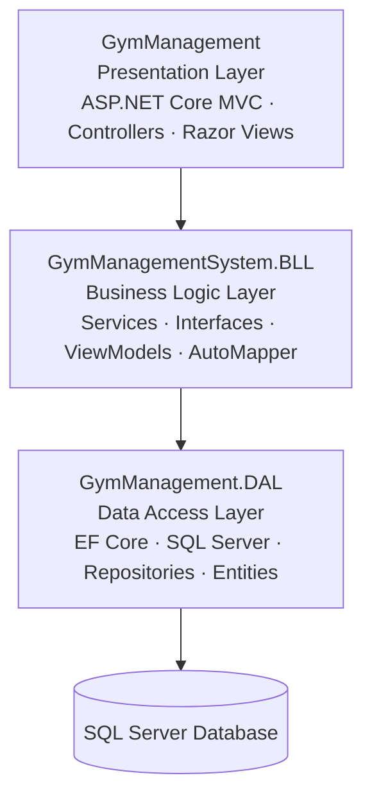

<div align="center">

# 🏋️ Gym Management System

### A complete gym administration web application built with ASP.NET Core MVC

<p>
  
  
  
  
</p>
<p>
  
  
  
  
</p>

**Manage members · Organize sessions · Track memberships · Handle bookings**

[Explore the Repository](https://github.com/HabibaElbehairy1/GymManagmentSystem) · [Report an Issue](https://github.com/HabibaElbehairy1/GymManagmentSystem/issues)

</div>

---

## ✨ About the Project

**Gym Management System** is an ASP.NET Core MVC application created to support the daily operations of a gym. It provides functionality for managing members and trainers, organizing membership plans and training sessions, handling bookings, and recording attendance.

The solution is built using a **three-layer architecture** that separates the presentation layer, business logic, and data access concerns.

## 🚀 Main Features

<table>
  <tr>
    <td width="50%">
      <h3>📊 Dashboard & Analytics</h3>
      <ul>
        <li>Total members and trainers</li>
        <li>Active memberships</li>
        <li>Upcoming, ongoing, and completed sessions</li>
      </ul>
    </td>
    <td width="50%">
      <h3>👥 Member Management</h3>
      <ul>
        <li>Create, view, update, and delete members</li>
        <li>Member profiles and health records</li>
        <li>Profile photo upload and retrieval</li>
      </ul>
    </td>
  </tr>
  <tr>
    <td width="50%">
      <h3>🏅 Trainer Management</h3>
      <ul>
        <li>Create, view, update, and delete trainers</li>
        <li>Manage contact details and specialties</li>
      </ul>
    </td>
    <td width="50%">
      <h3>🎟️ Memberships & Plans</h3>
      <ul>
        <li>Assign plans to members</li>
        <li>Track membership expiry</li>
        <li>Activate/deactivate plans and cancel active memberships</li>
      </ul>
    </td>
  </tr>
  <tr>
    <td width="50%">
      <h3>🗓️ Session Management</h3>
      <ul>
        <li>Create, view, update, and delete sessions</li>
        <li>Assign trainers and categories</li>
        <li>Track capacity and available slots</li>
      </ul>
    </td>
    <td width="50%">
      <h3>✅ Booking & Attendance</h3>
      <ul>
        <li>Book members into upcoming sessions</li>
        <li>Cancel bookings</li>
        <li>Record attendance for ongoing sessions</li>
      </ul>
    </td>
  </tr>
</table>

### 🔐 Authentication & Authorization

- User authentication and sign-in/sign-out using **ASP.NET Core Identity**.
- Role-based authorization for protected application areas.
- Initial Identity roles and administrator accounts are seeded during startup.

## 🧱 Architecture

The solution is organized into three projects, each with a clear responsibility:



| Project | Layer | Responsibility |
|---|---|---|
| **GymManagement** | Presentation | MVC controllers, Razor views, request handling, and application configuration. |
| **GymManagementSystem.BLL** | Business Logic | Application services, service interfaces, ViewModels, AutoMapper mappings, and operation results. |
| **GymManagement.DAL** | Data Access | DbContext, entities, Fluent API configurations, repositories, Unit of Work, migrations, and data seeding. |

### 🧩 Design Patterns & Practices

| Pattern / Practice | How it is used |
|---|---|
| **Repository Pattern** | Encapsulates data access operations. |
| **Generic Repository** | Reuses common data access methods across entities. |
| **Unit of Work** | Coordinates repositories and commits changes through a shared DbContext. |
| **Dependency Injection** | Injects services and repositories through abstractions. |
| **Asynchronous Programming** | Uses asynchronous database operations and cancellation tokens. |
| **AutoMapper** | Maps between entities and application ViewModels. |
| **EF Core Fluent Configuration** | Keeps entity mapping rules organized in separate configuration classes. |

## 🛠️ Technology Stack

<div align="center">
  
</div>

| Category | Technologies |
|---|---|
| Framework | .NET 10, ASP.NET Core MVC |
| Language | C# |
| ORM | Entity Framework Core 10 |
| Database | Microsoft SQL Server |
| Authentication | ASP.NET Core Identity |
| Object Mapping | AutoMapper |
| UI | Razor Views, HTML, CSS, JavaScript |
| Tools | Visual Studio, Git, GitHub |

## 📁 Project Structure

<details>
<summary><strong>View solution folder structure</strong></summary>

```text
GymManagmentSystem/
│
├── GymManagement/                       # Presentation Layer
│   ├── Controllers/
│   ├── Views/
│   ├── wwwroot/
│   ├── Program.cs
│   └── GymManagement.PL.csproj
│
├── GymManagementSystem.BLL/             # Business Logic Layer
│   ├── Common/
│   ├── Services/
│   │   ├── Attachment/
│   │   ├── Classes/
│   │   └── Interfaces/
│   ├── ViewModels/
│   ├── MappingProfile.cs
│   └── GymManagementSystem.BLL.csproj
│
├── GymManagement.DAL/                   # Data Access Layer
│   ├── Configurations/
│   ├── DataSeeding/
│   ├── Date/
│   │   └── Migrations/
│   ├── DbContexts/
│   ├── Models/
│   ├── Repositories/
│   │   ├── Classes/
│   │   └── Interfaces/
│   ├── UnitOfWork.cs
│   └── GymManagement.DAL.csproj
│
└── GymManagementSolutions.slnx
```

</details>

## ⚙️ Getting Started

### Prerequisites

- [.NET 10 SDK](https://dotnet.microsoft.com/download/dotnet/10.0)
- [Microsoft SQL Server](https://www.microsoft.com/en-us/sql-server)
- Visual Studio or another IDE that supports .NET 10

### 1. Clone the repository

```bash
git clone https://github.com/HabibaElbehairy1/GymManagmentSystem.git
cd GymManagmentSystem
```

### 2. Configure the database connection

Set the `DefaultConnection` connection string for your SQL Server instance. For local development, use **.NET User Secrets** instead of committing machine-specific settings:

```bash
dotnet user-secrets init --project GymManagement
dotnet user-secrets set "ConnectionStrings:DefaultConnection" "Server=YOUR_SERVER;Database=GymDb;Trusted_Connection=True;TrustServerCertificate=True;" --project GymManagement
```

Replace `YOUR_SERVER` with your SQL Server instance name.

### 3. Configure the initial administrator

The application seeds Identity roles and initial administrator accounts during startup. Configure these settings through User Secrets or environment variables:

- `AdminSeed:SuperAdminEmail`
- `AdminSeed:Password`
- `AdminSeed:AdminEmail`
- `AdminSeed:SuperAdminPhone`
- `AdminSeed:AdminPhone`

Example values (replace them with your own):

```bash
dotnet user-secrets set "AdminSeed:SuperAdminEmail" "superadmin@example.com" --project GymManagement
dotnet user-secrets set "AdminSeed:Password" "YOUR_STRONG_PASSWORD" --project GymManagement
dotnet user-secrets set "AdminSeed:AdminEmail" "admin@example.com" --project GymManagement
dotnet user-secrets set "AdminSeed:SuperAdminPhone" "YOUR_PHONE_NUMBER" --project GymManagement
dotnet user-secrets set "AdminSeed:AdminPhone" "YOUR_ADMIN_PHONE_NUMBER" --project GymManagement
```

> ⚠️ **Security:** Never commit real passwords, credentials, or connection strings. The current Identity seeding code includes fallback values. Replace those fallbacks with secure configuration and rotate any credentials that may have been exposed before deploying the application.

### 4. Apply database migrations

The application checks for pending EF Core migrations and applies them during startup. You can also update the database manually:

```bash
dotnet ef database update --project GymManagement.DAL --startup-project GymManagement
```

### 5. Build and run

```bash
dotnet build GymManagementSolutions.slnx
dotnet run --project GymManagement
```

Open the local URL displayed in the terminal.

## 🌱 Data Seeding

- Initial gym plan data is loaded from a JSON file.
- Identity roles and initial administrator accounts are created through the startup seeding process.
- Pending EF Core migrations are applied when the application starts.

## 👩‍💻 About the Developer

<div align="center">

### **Habiba Elbehairy**
Junior Backend .NET Developer

[](https://github.com/HabibaElbehairy1)

[View this project on GitHub](https://github.com/HabibaElbehairy1/GymManagmentSystem)

</div>

---

<div align="center">
  <sub>Built with C# and ASP.NET Core MVC · Thanks for visiting! 💜</sub>
</div>
